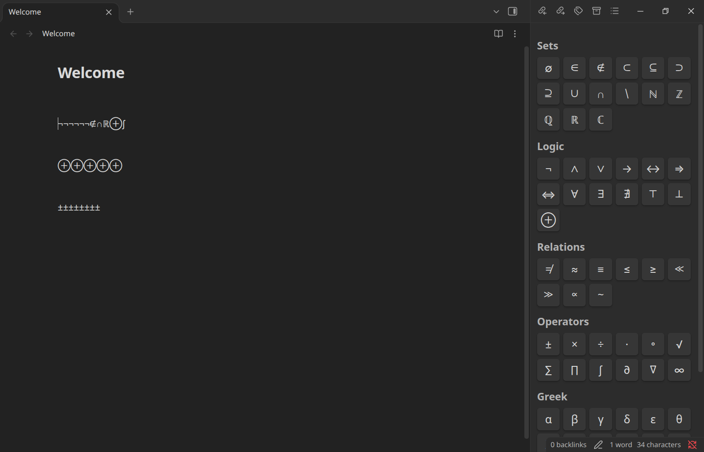

# Math Symbol Keyboard

A clickable keyboard of math, logic, and other special characters that lives in your Obsidian sidebar. Click a symbol and it's inserted at your cursor, so you never have to search the web for ∅, ∈, or ∀ again.



## What it does

Math Symbol Keyboard adds a **Symbols** panel to the right sidebar, with buttons grouped by category: sets, logic, relations, operators, Greek letters, and arrows. Clicking a button inserts that character into the note you were last editing, and your cursor goes straight back to the note so you can keep typing. The panel stays open, so you can insert as many symbols in a row as you like.

Hover over any button to see what the symbol is called, and for many symbols a short note on how it's used. For example, hovering ∈ shows "Element of" with the example "x ∈ A: x is in set A".

The symbol set is fully yours to change. You can rename, reorder, add, and delete groups, and add your own symbols with their own hover names and descriptions, all from the plugin's settings page. No code editing is required.

## Getting started

After enabling the plugin, open the panel by clicking the **Σ** icon in the left ribbon, or by running **Toggle symbol sidebar** from the command palette. The panel can be dragged anywhere in your workspace like any other sidebar view.

For quick access, assign a hotkey. Open Settings, go to Hotkeys, search for "symbol sidebar", and bind whatever shortcut you like (Ctrl+Shift+K works well). If you prefer a popup instead of a sidebar, there is also an **Open symbol picker (popup)** command, which shows the same buttons in a window and closes after you pick a symbol.

Symbols are inserted into notes in editing mode (Live Preview or Source mode). If your note is in Reading view, switch it to editing first.

## Adding your own symbols

Open Settings and select Math Symbol Keyboard under Community plugins. Each group appears as a collapsible section. Inside a group, every symbol has three fields: the character itself, the name shown on hover, and an optional description. Use **Add symbol** to add a new one to a group, the trash icon to remove one, and **Add group** at the bottom to create a new category. Changes are saved and appear in the sidebar immediately.

To make bulk changes, or to share your symbol set with someone else, use the **Edit as JSON** section at the bottom of the settings page. It shows your entire symbol list as JSON that you can edit, paste over, or copy. The format looks like this:

```json
[
  {
    "group": "Sets",
    "items": [
      { "ch": "∅", "name": "Empty set", "desc": "The set with no elements" },
      { "ch": "∈", "name": "Element of" }
    ]
  }
]
```

Every group needs a `group` name and an `items` list. Every symbol needs a `ch` (the character) and a `name`; the `desc` field is optional. The plugin checks your JSON before saving and tells you if something is wrong, so a typo can't break your setup. If you ever want to start over, **Reset to defaults** restores the built-in symbol set.

Your symbols are stored in the plugin's `data.json` file inside your vault's `.obsidian/plugins/math-symbol-keyboard/` folder, so they survive plugin updates and sync with your vault.

## Installation

Once the plugin is listed in the community directory, open Settings, go to Community plugins, select Browse, search for "Math Symbol Keyboard", then install and enable it.

To install manually, download `main.js`, `manifest.json`, and `styles.css` from the latest [release](../../releases), place them in a folder named `math-symbol-keyboard` inside your vault's `.obsidian/plugins/` directory, then reload Obsidian and enable the plugin under Community plugins.

## Feedback

Bug reports and feature ideas are welcome. Please open an issue on this repository.

## License

Released under the [MIT License](LICENSE).